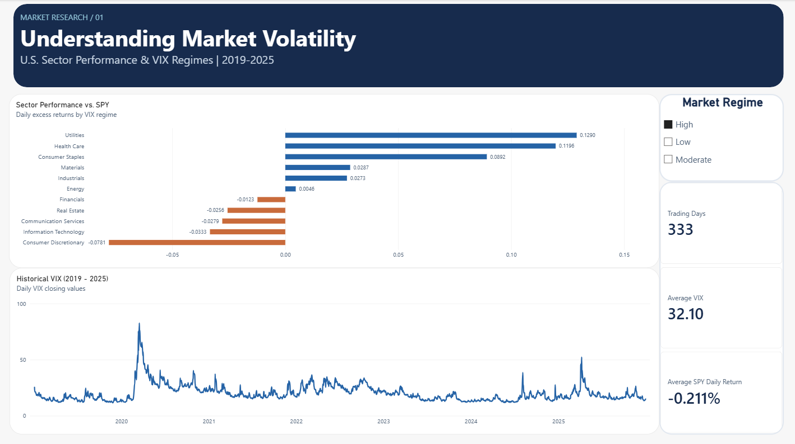
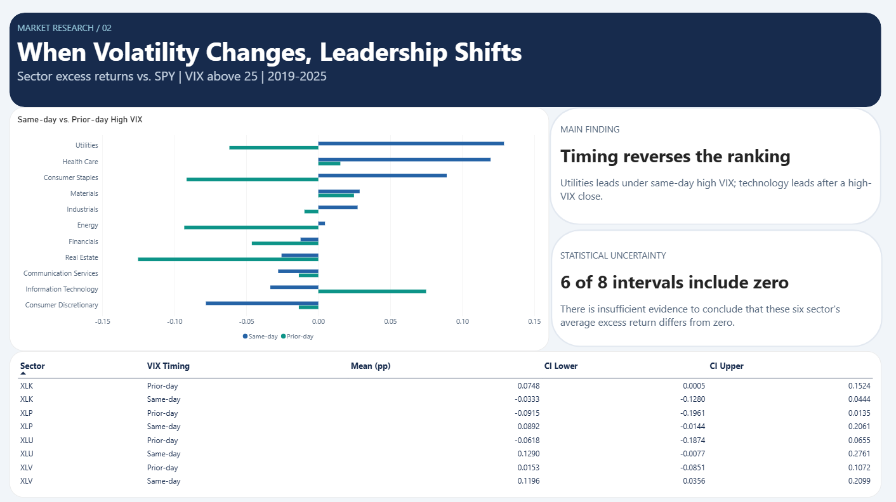
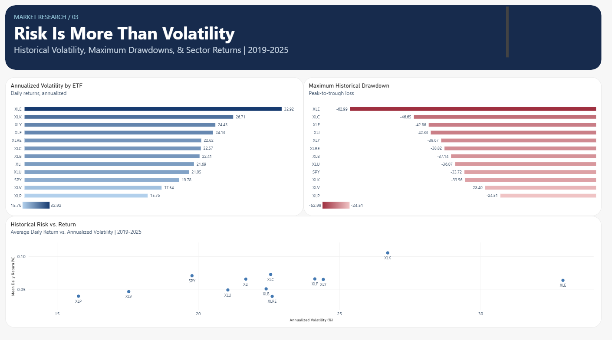

# Market Risk Analytics
### U.S. Sector Performance, Volatility Regimes & Historical Risk | 2019–2025

**Python · SQLite / SQL · Power BI · Statistical Bootstrap**

An end-to-end exploratory analysis of how U.S. equity sectors perform relative to the S&P 500 during different market-volatility regimes. The project combines historical ETF and CBOE Volatility Index (VIX) observations, relational SQL analytics, Python-based uncertainty estimates, and a three-page Power BI report.

**Research question:** Does sector leadership relative to SPY change when elevated market volatility is measured *on the same day* versus *on the preceding trading day*?

> **Scope:** Historical, descriptive research—not investment advice, an executable trading strategy, or evidence that the observed relationships are causal or forecastable.

## Findings

- **Timing materially changes the ranking.** On days with VIX above 25, Utilities (XLU) averaged **+0.1290 percentage points** of daily excess return over SPY and Health Care (XLV) averaged **+0.1196 pp**. When the regime is based on the *previous* trading day's VIX, Technology (XLK) leads the four selected focus sectors at **+0.0748 pp**.
- **Uncertainty matters.** Six of eight exploratory moving-block-bootstrap 95% confidence intervals include zero. For the same-day high-VIX XLV result, the 20-day-block interval is **[+0.0356, +0.2099] pp**; for prior-day high-VIX XLK, it is **[+0.0005, +0.1524] pp**, but its 10-day-block sensitivity interval crosses zero.
- **Volatility and drawdown are different risks.** Energy (XLE) recorded approximately **32.92%** annualized historical return volatility and a **−62.99%** maximum drawdown. Communication Services (XLC) had a deeper drawdown than Technology (XLK), despite lower annualized volatility.
- **Stress observations are clustered.** Approximately **284 of 333** high-VIX sample days fall in 2020 or 2022, so treating these days as independent market stress episodes would overstate the breadth of evidence.

All values refer to the analyzed historical data snapshot, not live or forward-looking market estimates.

## Dataset and scope

| Item | Coverage |
| --- | --- |
| Historical window | January 2, 2019 – December 31, 2025 |
| Equity instruments | SPY (S&P 500 benchmark) + 11 Select Sector SPDR ETFs |
| Sector ETFs | XLB, XLC, XLE, XLF, XLI, XLK, XLP, XLRE, XLU, XLV, XLY |
| Stored ETF price records | 21,120 (1,760 per instrument) |
| Stored VIX observations | 1,760 |
| Joined sector-day observations | 19,349 (11 sectors × 1,759 return days) |
| High-VIX days, same-day definition | 333 |

**Source:** Historical market series downloaded with [yfinance](https://github.com/ranaroussi/yfinance), which retrieves data from Yahoo Finance. ETF returns use adjusted price data; the VIX series uses closing values. Re-downloaded data may be revised or differ from the original snapshot. No original market data is committed to this repository.

### Volatility definitions

| Regime | VIX closing level |
| --- | --- |
| Low | Below 15 |
| Moderate | 15 through 25 |
| High | Above 25 |

The **same-day** specification classifies the sector's daily return using that day's VIX close. The **prior-day** specification instead uses the preceding trading day's VIX close. Because same-day VIX is observed contemporaneously with the sector return, its association **must not be interpreted as an ex-ante trading signal**.

## Methodology

1. **Ingest and validate:** `main.py` creates the database using `sql/schema.sql`, downloads historical ETF prices and VIX data as needed, creates reporting views, and checks ETF coverage, duplicate ticker-date records, prices, and matching VIX dates.
2. **Compute SQL analytics:** `sql/reporting.sql` defines six SQLite views covering daily returns, daily sector-versus-SPY excess returns, current/prior VIX regimes, sector regime summaries, historical peak-to-trough drawdowns, a sample weighted portfolio, and sector risk metrics.
3. **Assess statistical uncertainty:** `analysis.py` computes mean excess returns for four focus sectors (XLK, XLV, XLU, XLP), using a circular moving-block bootstrap of consecutive trading-day observations (1,000 replicates; 20-day blocks), with 10-day and 40-day block-length sensitivity checks (2,000 replicates).
4. **Report:** The locally produced CSV summaries feed a three-page Power BI dashboard: **Market Overview**, **Market Regime Analysis**, and **Risk & Volatility**.

Returns and excess returns are converted into percentage points for presentation. Historical volatility is annualized with `sqrt(252)`; maximum drawdown is the minimum percentage deviation from a running peak.

### SQL reporting views

| View | Purpose |
| --- | --- |
| `daily_returns` | Daily ETF returns from adjusted prices |
| `sector_market_daily` | SPY-relative daily returns joined to same-day and lagged VIX regimes |
| `sector_regime_summary` | Conditional sector performance by timing and VIX regime |
| `price_drawdowns` | Daily distance below running historical price peak |
| `sector_risk_summary` | Annualized volatility, mean returns and maximum drawdown |
| `portfolio_daily_returns` | Illustrative weighted XLK/XLE/XLP return series |

## Reproduce the analysis

Requires Python and an internet connection for the initial market-data download. The project was developed with Python 3.13 and the dependencies in `requirements.txt`.

```bash
git clone https://github.com/JReader1/Market-Risk-Analytics.git
cd Market-Risk-Analytics
python -m venv .venv
```

Activate the environment:

**Windows PowerShell**
```powershell
.\.venv\Scripts\Activate.ps1
```

**macOS / Linux**
```bash
source .venv/bin/activate
```

Then:

```bash
python -m pip install -r requirements.txt
python main.py
python analysis.py
```

`main.py` creates `data/market-risk.sqlite` from the committed SQL scripts and populates the market observations. `analysis.py` produces `data/sector_market_daily.csv`, `data/bootstrap_results.csv`, and `data/sector_risk_summary.csv`.

**Important reproduction caveats:**
- Initial downloads are sourced from Yahoo Finance and may not exactly match the stored 2019–2025 research snapshot.
- The download cache skips an ETF once *any* price records are present and skips VIX once *any* observations exist; it is not a robust incremental updater for partially populated data. To retry a failed or incomplete import, use a separate fresh database or inspect the relevant records rather than assuming a re-run will fill gaps.
- An in-memory SQL reconstruction and a separate empty-database initialization test passed. Matching historical risk summaries were also reproduced from copied observations. A completely independent fresh market-data download has **not** been validated against the original snapshot.
- The Power BI report is built from generated CSV files; anyone refreshing a local `.pbix` will need to configure its file paths.

## Repository layout

```text
Market-Risk-Analytics/
├── main.py                # Market-data ingestion and database validation
├── analysis.py            # Bootstrap, sensitivity checks and CSV exports
├── requirements.txt       # Python dependencies
├── sql/
│   ├── schema.sql         # Tables, indexes and 12 ETF instrument definitions
│   └── reporting.sql      # Six reporting views
├── dashboard/
│   ├── Market-Risk-Analytics.pbix
│   └── screenshots/
│       ├── market-overview.png
│       ├── market-regimes.png
│       └── risk-volatility.png
└── .gitignore
```

## Power BI dashboard

The completed three-page Power BI report is available as [Market-Risk-Analytics.pbix](dashboard/Market-Risk-Analytics.pbix). The report uses locally generated CSV outputs; configure source paths in Power BI Desktop before refreshing on another machine.

### 01 — Market Overview


### 02 — Market Regime Analysis


### 03 — Risk & Volatility



## Limitations and interpretation

- **Association, not causation:** Volatility regimes and excess sector returns are historically associated; the analysis does not isolate causal effects.
- **Timing:** Same-day VIX classification uses information not known before that day's close and can create look-ahead problems if mistakenly used as a prospective decision rule.
- **Dependent samples:** High-volatility observations cluster in calendar time. The moving-block bootstrap addresses some serial dependence but does not create independent market crises.
- **Exploratory inference:** Intervals are unadjusted for multiple comparisons; overlapping zero and sensitivity to block length limit inferential strength. Results should not be advertised as statistically validated trading signals.
- **Survivorship and coverage:** The instrument set is a fixed universe of currently specified sector ETFs. The historical window and these ETFs do not capture every market regime, individual stock, or transaction cost.
- **Portfolio illustration:** The weighted-portfolio view is an illustrative historical return series; it is not an optimized or transaction-cost-adjusted backtest.

## Project purpose

This portfolio project demonstrates practical data-engineering and analytics skills: normalized relational tables, SQL window functions and views, input validation, Python statistical analysis, uncertainty reporting, and dashboard storytelling.

**Status:** Python, SQL, Power BI report and screenshots published. Database rebuild from stored observations verified; independent full Yahoo Finance re-download not yet verified.
